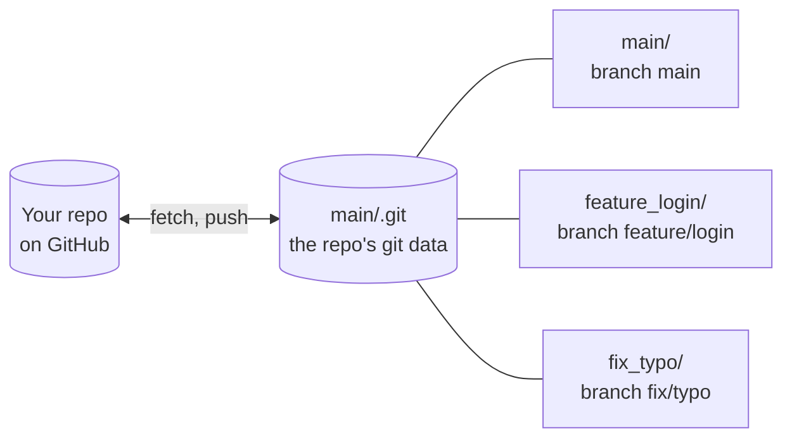

# wt: a git worktree manager

A git worktree is an extra folder for the same repo, with a different branch checked out. `wt` keeps one of these folders per branch, side by side, so you can switch branches by changing folders instead of stashing and checking out:

```text
<repo-location>/          <- one folder for the repo
├── main/                 <- branch main
├── feature_login/        <- branch feature/login
└── fix_TICKET-12_typo/   <- branch fix/TICKET-12/typo
```

`wt add <branch>` makes a folder for a branch and moves you into it, `wt ls` shows the state of every folder, and `wt clean` deletes the ones whose pull requests are finished.

These scripts are part of [github.com/alisonhall/dotfiles](https://github.com/alisonhall/dotfiles), but don't depend on anything else in it. You can download just this folder.

## Requirements

**You need:**

- **bash and git.** The scripts run in bash. The terminal you type in can use bash or zsh.
- **A repo hosted on GitHub.**
- **The GitHub CLI, `gh`, logged in to GitHub.** Install it from [cli.github.com](https://cli.github.com), then run `gh auth login` once. `wt clean` uses it to see which pull requests are merged, and won't run without it. `wt add` and `wt cd` use it to bring back a branch that was deleted from GitHub after its pull request was merged.

**Only if your repo is a JavaScript monorepo with npm or yarn workspaces:**

- **Node.js 14.18 or later.** See [Node projects](#node-projects).

`wt` is written for macOS and Linux. It also runs in Git Bash on Windows, with [some limits](#windows).

## Placeholders

The instructions below use these placeholders. Replace each one, including its `<` and `>`, with your own value:

| Placeholder | Replace it with |
| --- | --- |
| `<wt-folder>` | The folder you put the `wt` scripts in, in [step 1](#1-download-the-scripts). |
| `<repo-owner>` | The GitHub user or organization that owns your repo: the first part of its URL after `github.com/`. |
| `<repo-name>` | Your repo's name: the part of its URL after `<repo-owner>/`. |
| `<repo-location>` | The folder that will hold your repo's branch folders, set up in [step 4](#4-set-up-the-repos-folder). It can be anywhere. |
| `<command-name>` | A name you choose for your repo's `wt` command, in [step 3](#3-tell-wt-where-your-repo-is). |

Write folder paths starting with `$HOME` rather than `~` (for example `$HOME/code/<repo-name>`), because `~` doesn't work inside quotes.

## Install

### 1. Download the scripts

Put the `wt` folder anywhere you like. That folder is your `<wt-folder>`. Choose one way to download:

**Without the command line:** on [the repo's GitHub page](https://github.com/alisonhall/dotfiles), click **Code**, then **Download ZIP**. Unzip it, and move the `git/wt` folder inside it to wherever you want to keep it.

**With curl:** downloads only the `wt` folder.

```sh
mkdir -p "<wt-folder>"
curl -fsSL https://github.com/alisonhall/dotfiles/archive/refs/heads/main.tar.gz |
    tar -xz --strip-components=3 -C "<wt-folder>" dotfiles-main/git/wt
```

**With git:** you can update it later with `git pull`. Clone into any folder; the scripts end up in a `git/wt` folder inside it, so your `<wt-folder>` is `<folder-to-clone-into>/git/wt`.

```sh
git clone --depth 1 --filter=blob:none --sparse https://github.com/alisonhall/dotfiles.git "<folder-to-clone-into>"
git -C "<folder-to-clone-into>" sparse-checkout set git/wt
# To update the scripts later:
git -C "<folder-to-clone-into>" pull
```

### 2. Load `wt` in your terminal

Your terminal runs a startup file each time it opens. Which one depends on your shell:

| Your shell | Usually on | Startup file |
| --- | --- | --- |
| zsh | macOS | `~/.zshrc` |
| bash | Linux, Git Bash on Windows | `~/.bashrc` |

Not sure which shell you use? Run `echo $SHELL`.

Add this line to that file:

```sh
. "<wt-folder>/wt.sh"
```

Open a new terminal and run `wt help`. If it lists the commands, `wt` is loaded.

`wt` is loaded this way, as a shell function, rather than run as a script, because a script can't change your terminal's current folder, and `wt add`, `wt cd` and `wt main` do.

### 3. Tell `wt` where your repo is

`wt` reads its settings from environment variables, so one copy can work with several repos. The easiest way to set them is to make your own command for each repo. Add a line like this to the same startup file as in step 2 (`~/.zshrc` or `~/.bashrc`):

```sh
alias <command-name>='WT_WORKTREE_REPO_LOCATION="<repo-location>" WT_REPO_SLUG=<repo-owner>/<repo-name> wt'
```

| Part | What it is |
| --- | --- |
| `<command-name>` | The name of your new command. Pick any name that isn't already a command, such as the repo's name followed by `-wt`. |
| `WT_WORKTREE_REPO_LOCATION="<repo-location>"` | The folder that holds the repo's branch folders, which you'll set up in step 4. |
| `WT_REPO_SLUG=<repo-owner>/<repo-name>` | The repo's owner and name, as in its URL: `github.com/<repo-owner>/<repo-name>`. |
| `wt` | Runs `wt` with those settings. They apply only to this command, not to the rest of your terminal. |

Open a new terminal, then type your command wherever this README says `wt`: `<command-name> add feature/login`, `<command-name> ls` and so on. For another repo, add another line with a different name and values.

If you only use `wt` with one repo, you can set the variables for every command instead, and type `wt` itself:

```sh
export WT_WORKTREE_REPO_LOCATION="<repo-location>"
export WT_REPO_SLUG=<repo-owner>/<repo-name>
```

[Settings](#settings) lists the other variables you can set the same way.

### 4. Set up the repo's folder

`wt` needs the repo in a particular shape: one folder, `<repo-location>`, with a normal clone of the repo inside it in a folder named `main`. `wt` adds a folder next to `main` for each branch you work on.

Only `main` has the repo's `.git` folder. Each branch folder has a `.git` *file* instead: one line that points back into `main/.git`.

```text
<repo-location>/              <- WT_WORKTREE_REPO_LOCATION points here. This folder isn't
│                                a git repo itself; it just holds the folders below.
│
├── main/                     <- a normal clone of the repo. It must be named "main".
│   ├── .git/                 <- a FOLDER: the repo's history, branches and settings
│   └── (your repo's files)
│
├── feature_login/            <- made by `wt add feature/login`
│   ├── .git                  <- a FILE, containing one line:
│   │                            gitdir: <repo-location>/main/.git/worktrees/feature_login
│   └── (your repo's files, as they are on feature/login)
│
└── fix_typo/                 <- made by `wt add fix/typo`
    ├── .git                  <- a FILE, pointing into main/.git the same way
    └── (your repo's files, as they are on fix/typo)
```

Because every branch folder uses the git data in `main/.git`, a commit made in one folder is visible from all of them, and there's only one copy of the history to fetch:



Folder names are the branch name with each `/` changed to `_`, because `/` would make nested folders.

**To start with a fresh clone:**

```sh
mkdir -p "<repo-location>"
git clone git@github.com:<repo-owner>/<repo-name>.git "<repo-location>/main"
```

**To use a clone you already have** at `<repo-location>`, move it down a level into `main`:

```sh
mv "<repo-location>" "<repo-location>-main"
mkdir "<repo-location>"
mv "<repo-location>-main" "<repo-location>/main"
git -C "<repo-location>/main" worktree repair    # reconnects any worktrees you made before
```

**Common mistakes:**

| | Layout | Why it doesn't work |
| --- | --- | --- |
| ❌ | The clone is `<repo-location>` itself, with no `main` folder in it | `wt` looks for the clone in `<repo-location>/main` |
| ❌ | `WT_WORKTREE_REPO_LOCATION="<repo-location>/main"` | Point it at `<repo-location>`, the folder that contains `main`, not at `main` itself |
| ❌ | The clone is in `<repo-location>/develop` because the default branch is `develop` | The folder must be named `main`, whatever its branch. Set `CURRENT_DEV_BRANCH=develop` (see [Settings](#settings)) so new branches start from `develop` |
| ✅ | `<repo-location>/main` is a clone, and `WT_WORKTREE_REPO_LOCATION="<repo-location>"` | |

#### The bare-repo layout

Some people set up worktrees differently, with a "bare" repo. A bare repo is only git's data (what's normally in a `.git` folder), with no files checked out. In this layout the bare repo sits in a hidden `.bare` folder, and every branch, including `main`, is a worktree with a `.git` file that points to it:

```text
<repo-location>/
├── .bare/          <- a FOLDER: the bare repo, with the git data and no files
├── main/           <- a worktree, like every other branch folder
│   ├── .git        <- a FILE that points into ../.bare
│   └── (your repo's files)
└── feature_login/
    ├── .git        <- a FILE that points into ../.bare
    └── (your repo's files, as they are on feature/login)
```

`wt` works with this layout too, so if you already use it, there's nothing to change. If you're starting fresh, use the normal clone above: `git clone --bare` doesn't connect each branch to its GitHub branch, so `wt ls` can't show how far ahead or behind they are until you set that up yourself.

## Commands

The commands are written with `wt`. If you made your own command in [step 3](#3-tell-wt-where-your-repo-is), type `<command-name>` instead.

`<branch>` is always the branch's name as it is on GitHub, like `feature/login`, not its folder name.

| Command | What it does | Options |
| --- | --- | --- |
| `wt add <branch>` | Creates a folder for `<branch>` in `<repo-location>` (for `feature/login`, that's `feature_login/`), and moves your terminal into it. If `<branch>` exists on GitHub, the folder tracks it. If not, `wt` creates `<branch>` as a new branch from `main` (or from `CURRENT_DEV_BRANCH`). If the folder already exists, `wt` just moves you into it. | |
| `wt cd <branch>` | Moves your terminal into `<branch>`'s folder, and downloads the branch's latest commits from GitHub without changing your files (run `git pull` to apply them). If the folder doesn't exist yet, `wt cd` creates it first, the same way `wt add` does. | |
| `wt main` | Moves your terminal into `<repo-location>/main`. | |
| `wt ls` | Lists every branch folder with its branch, whether that branch still exists on GitHub, whether the folder has uncommitted or untracked changes, and how many commits the branch is ahead of or behind GitHub. Changes nothing. | `--no-fetch`: skip checking GitHub first. Faster, and works offline, but the ahead/behind numbers may be out of date |
| `wt clean` | Lists the branch folders that are safe to delete: their pull request is merged or closed, and they have no work that isn't on GitHub. Deletes nothing unless you add `--apply`. See [what `wt clean` keeps](#what-wt-clean-keeps). | `--apply`: delete those folders and their local branches<br>`--keep-branch`: with `--apply`, delete the folders but keep the local branches<br>`--older-than 30d`: only folders whose last commit is older than 30 days (also `12h`, `4w`, `90m` for minutes) |
| `wt rm <branch>` | Deletes `<branch>`'s folder right away. **It doesn't check for uncommitted changes, so anything in that folder that isn't committed is lost.** The branch itself is kept. `wt clean` is the safe way to tidy up. | |
| `wt link <branch>`<br>`wt link --all` | Checks that a branch folder's shared links (to `node_modules`, and to anything in `WT_SYMLINK_PAIRS`) point into `main`, and repairs any that are missing or broken. Give one branch, or `--all` for every branch folder. See [Shared files](#shared-files-node_modules-env). | `--check`: report problems, but don't repair them<br>`--no-workspaces`: skip the [Node workspace](#node-projects) links (faster) |
| `wt help` | Lists the commands, options and settings. | |

### What `wt clean` keeps

`wt clean` checks pull requests on GitHub, because a squash merge leaves nothing in git's history to show that a branch was merged. It only deletes a branch folder when all of these are true:

1. The branch's pull request is merged or closed.
2. The branch was pushed to GitHub at some point.
3. The branch has no commits that aren't on GitHub (on the branch, or in the pull request if the branch was deleted).
4. The folder has no uncommitted changes, and no new or ignored files other than shared links and build output (`node_modules`, `dist`, `build`, `coverage` and the like).
5. The branch has no stashes.

`wt clean` lists every folder it keeps, with the reason. Branches in `WT_PROTECTED_BRANCHES` (`main`, unless you change it) are never deleted.

## Settings

Set these in the same place as in [step 3](#3-tell-wt-where-your-repo-is):

- **For one repo:** add them to that repo's command in `~/.zshrc` or `~/.bashrc`. With several settings, a function is easier to read than an alias. It works the same way:

  ```sh
  <command-name>() {
      WT_WORKTREE_REPO_LOCATION="<repo-location>" \
      WT_REPO_SLUG=<repo-owner>/<repo-name> \
      CURRENT_DEV_BRANCH=develop \
      WT_SYMLINK_PAIRS=".env" \
      wt "$@"
  }
  ```

- **For every repo:** `export` them in `~/.zshrc` or `~/.bashrc`, for example `export CURRENT_REMOTE_NAME=upstream`. A setting in a repo's command overrides one exported for every repo.

Open a new terminal after changing either file.

| Setting | Needed? | Default | What it's for |
| --- | --- | --- | --- |
| `WT_WORKTREE_REPO_LOCATION` | Always | | `<repo-location>`: the folder that contains `main/` (see [step 4](#4-set-up-the-repos-folder)) |
| `WT_REPO_SLUG` | For `wt clean` | | `<repo-owner>/<repo-name>`: the GitHub repo's owner and name |
| `CURRENT_DEV_BRANCH` | No | `main` | The branch that `wt add` starts new branches from |
| `CURRENT_REMOTE_NAME` | No | `origin` | The git remote that points at GitHub |
| `WT_PROTECTED_BRANCHES` | No | `main` | Branches `wt clean` never deletes, separated by spaces, like `"main develop"` |
| `WT_SAFE_ARTIFACTS` | No | | More files or folders that `wt clean` may delete along with a branch folder, separated by spaces, like `".cache bundle-analysis.html"`. Use it for generated files your repo ignores, so they don't stop a folder being cleaned |
| `WT_SYMLINK_PAIRS` | No | | Files or folders that every branch folder should share with `main` rather than have its own copy of, separated by spaces, like `".env .cache"` (see [Shared files](#shared-files-node_modules-env)) |

## Shared files (node_modules, .env)

Each new branch folder gets a `node_modules` link to `main/node_modules`, so you don't have to install dependencies again for every branch. To share other files or folders the same way, like `.env`, add them to `WT_SYMLINK_PAIRS`.

`wt link --check --all` shows which branch folders have missing or broken links, and `wt link --all` repairs them. If a branch folder has a real file or folder where a link should be, `wt link` reports it but leaves it alone, since it may hold work you want to keep.

In a repo with no `main/node_modules`, the `node_modules` link points at nothing. That's harmless. On Windows, `ln` prints an error instead.

### Node projects

In a JavaScript monorepo with npm or yarn `workspaces`, the shared `node_modules` would make imports of the repo's own packages (like `@<scope>/<package>`) load `main`'s copy of them. If Node.js is installed, `wt add` and `wt link` add small extra links (with `link-workspaces.mjs`) so those imports load the code in the current branch folder instead. Other repos aren't affected.

## Windows

`wt` runs in Git Bash, with these limits:

- **Shared links:** Git Bash's `ln -s` copies a folder instead of linking to it, so each branch folder gets its own copy of `node_modules`. To get real links, turn on Windows Developer Mode and add `export MSYS=winsymlinks:nativestrict` to `~/.bashrc`.
- **`wt ls`** marks every folder `[outside]`, because Git Bash writes the same folder in two forms (like `/c/Users/...` and `C:/Users/...`). The rest of its report is right.

## Uninstall

Remove the lines you added to `~/.zshrc` or `~/.bashrc`, and delete `<wt-folder>` (or `<folder-to-clone-into>`, if you used git). Your branch folders are ordinary git worktrees, so `git worktree list` and `git worktree remove` still work without `wt`.
