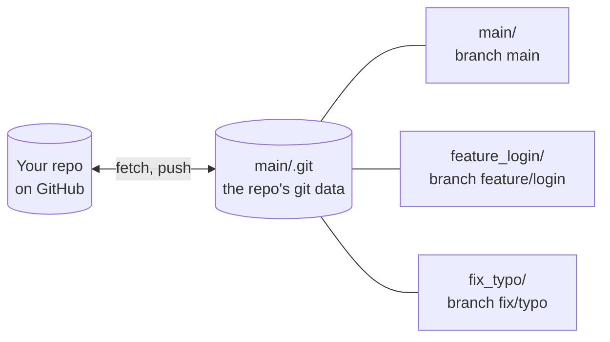

# wt: a git worktree manager

A git worktree is an extra folder for the same repo, with a different branch checked out. `wt` keeps one of these folders per branch, side by side, so you can switch branches by changing folders instead of stashing and checking out:

```text
<repo-location>/          <- one folder for the repo
├── main/                 <- branch main
├── feature_login/        <- branch feature/login
└── fix_TICKET-12_typo/   <- branch fix/TICKET-12/typo
```

`wt add <branch>` makes a folder for a branch and moves you into it, `wt ls` shows the state of every folder, and `wt clean` deletes the ones whose pull requests are finished.

These scripts are part of [github.com/alisonhall/dotfiles](https://github.com/alisonhall/dotfiles), but don't depend on anything else in it. You can download just this folder.

## Requirements

**You need:**

- **bash and git.** The scripts run in bash. The terminal you type in can use bash or zsh.
- **A repo hosted on GitHub.**
- **The GitHub CLI, `gh`, logged in to GitHub.** Install it from [cli.github.com](https://cli.github.com), then run `gh auth login` once. `wt clean` uses it to see which pull requests are merged, and won't run without it. `wt add` and `wt cd` use it to bring back a branch that was deleted from GitHub after its pull request was merged.

**Only if your repo is a JavaScript monorepo with npm or yarn workspaces:**

- **Node.js 14.18 or later.** See [Node projects](#node-projects).

`wt` is written for macOS and Linux. It also runs in Git Bash on Windows, with [some limits](#windows).

## Placeholders

The instructions below use these placeholders. Replace each one, including its `<` and `>`, with your own value:

| Placeholder | Replace it with |
| --- | --- |
| `<wt-folder>` | The folder you put the `wt` scripts in, in [step 1](#1-download-the-scripts). |
| `<repo-owner>` | The GitHub user or organization that owns your repo: the first part of its URL after `github.com/`. |
| `<repo-name>` | Your repo's name: the part of its URL after `<repo-owner>/`. |
| `<repo-location>` | The folder that will hold your repo's branch folders, set up in [step 2](#2-run-the-setup) or [step C](#c-set-up-the-repos-folder). It can be anywhere. |
| `<command-name>` | A name you choose for your repo's `wt` command, in [step 2](#2-run-the-setup) or [step B](#b-tell-wt-where-your-repo-is). |

Write folder paths starting with `$HOME` rather than `~` (for example `$HOME/code/<repo-name>`), because `~` doesn't work inside quotes.

## Install

### 1. Download the scripts

Put the `wt` folder anywhere you like. That folder is your `<wt-folder>`. Choose one way to download:

**Without the command line:** on [the repo's GitHub page](https://github.com/alisonhall/dotfiles), click **Code**, then **Download ZIP**. Unzip it, and move the `git/wt` folder inside it to wherever you want to keep it.

**With curl:** downloads only the `wt` folder.

```sh
mkdir -p "<wt-folder>"
curl -fsSL https://github.com/alisonhall/dotfiles/archive/refs/heads/main.tar.gz |
    tar -xz --strip-components=3 -C "<wt-folder>" dotfiles-main/git/wt
```

**With git:** you can update it later with `git pull`. Clone into any folder; the scripts end up in a `git/wt` folder inside it, so your `<wt-folder>` is `<folder-to-clone-into>/git/wt`.

```sh
git clone --depth 1 --filter=blob:none --sparse https://github.com/alisonhall/dotfiles.git "<folder-to-clone-into>"
git -C "<folder-to-clone-into>" sparse-checkout set git/wt
# To update the scripts later:
git -C "<folder-to-clone-into>" pull
```

### 2. Run the setup

The setup script does the rest for you. Run it for each repo you want to use with `wt`:

```sh
bash "<wt-folder>/wt-setup.sh"
```

Once `wt` is loaded, `wt setup` runs it too. It asks:

1. **Which repo:** its GitHub `<repo-owner>/<repo-name>`, or a URL to clone. If you run it from inside a clone, it offers that repo. It checks that it can reach the repo before going on.
2. **Which folder to keep it in** (`<repo-location>`), and how to get the clone into `<repo-location>/main`: clone it from GitHub, or move a clone you already have. If `<repo-location>/main` is already a clone, it uses that.
3. **Which startup file loads `wt`.** It suggests `~/.zshrc` or `~/.bashrc`, depending on your shell.
4. **A name for a command for the repo** (`<command-name>`), which runs `wt` for it from any folder. In the repo's own folders plain `wt` works, so answer `-` if you don't want one. It won't use a name that's already a command, or that the startup file already has an alias or function for.
5. **The branch new branches start from**, offering the repo's default branch, and any files to [share between branch folders](#shared-files-node_modules-env).

Every question has a default, shown in `[brackets]`, so you can press Enter to accept it. Then it shows exactly what it will do and asks before doing it. It backs up each file before changing it, then:

- clones or moves the repo into `<repo-location>/main`, and reconnects any worktrees you'd already made from a clone it moves
- saves the repo's [settings](#settings) in the clone's git config (`wt.repoSlug`, `wt.symlinkPair`, and `wt.devBranch` if it isn't the repo's default branch)
- adds a line that loads `wt`, unless the file loads it already
- adds the repo's command, if you chose one, between `# >>> wt: <command-name> >>>` and `# <<< wt: <command-name> <<<` lines. It only sets `WT_WORKTREE_REPO_LOCATION`, since the other settings are in git config
- on macOS and Windows, if you use bash, makes `~/.bash_profile` load `~/.bashrc` if it doesn't already. New terminals there read `~/.bash_profile`, not `~/.bashrc`
- on Windows, if you say yes, lets git use paths longer than 260 characters (see [Windows](#windows))

Running it again updates the settings it asks about, and offers the ones already saved as the defaults. A command written by an earlier version of the setup, with the settings in it, has them moved into git config. Settings it doesn't ask about (like `wt.protectedBranch`) are left alone. To see what it would do without changing anything, run it with `--dry-run`.

Then open a new terminal and try `wt ls` in `<repo-location>/main` (or `<command-name> ls` anywhere).

### Or set up by hand

These steps do the same as the setup script.

#### A. Load `wt` in your terminal

Your terminal runs a startup file each time it opens. Which one depends on your shell:

| Your shell | Usually on | Startup file |
| --- | --- | --- |
| zsh | macOS | `~/.zshrc` |
| bash | Linux, Git Bash on Windows | `~/.bashrc` |

Not sure which shell you use? Run `echo $SHELL`.

Add this line to that file:

```sh
. "<wt-folder>/wt.sh"
```

Open a new terminal and run `type wt`. If it says `wt is a function`, `wt` is loaded. (On Windows, `wt` is also Windows Terminal's command, so `wt help` would open Windows Terminal until this `wt` is loaded. See [Windows](#windows).)

`wt` is loaded this way, as a shell function, rather than run as a script, because a script can't change your terminal's current folder, and `wt add`, `wt cd` and `wt main` do.

#### B. Tell `wt` where your repo is

Run in the repo's `main` folder or a branch folder beside it, `wt` finds the repo itself, and reads the repo's settings from its git config (see [Settings](#settings)). So once the repo is laid out as in step C, you can skip this step and use plain `wt` there.

To also run `wt` for the repo from other folders, make your own command for it. Add a line like this to the same startup file as in step A (`~/.zshrc` or `~/.bashrc`):

```sh
alias <command-name>='WT_WORKTREE_REPO_LOCATION="<repo-location>" WT_REPO_SLUG=<repo-owner>/<repo-name> wt'
```

| Part | What it is |
| --- | --- |
| `<command-name>` | The name of your new command. Pick any name that isn't already a command, such as the repo's name followed by `-wt`. |
| `WT_WORKTREE_REPO_LOCATION="<repo-location>"` | The folder that holds the repo's branch folders, which you'll set up in step C. |
| `WT_REPO_SLUG=<repo-owner>/<repo-name>` | The repo's owner and name, as in its URL: `github.com/<repo-owner>/<repo-name>`. |
| `wt` | Runs `wt` with those settings. They apply only to this command, not to the rest of your terminal. |

Open a new terminal, then type your command wherever this README says `wt`: `<command-name> add feature/login`, `<command-name> ls` and so on. For another repo, add another line with a different name and values.

If you only use `wt` with one repo, you can set the variables for every command instead, and type `wt` itself:

```sh
export WT_WORKTREE_REPO_LOCATION="<repo-location>"
export WT_REPO_SLUG=<repo-owner>/<repo-name>
```

[Settings](#settings) lists the other variables you can set the same way.

#### C. Set up the repo's folder

`wt` needs the repo in a particular shape: one folder, `<repo-location>`, with a normal clone of the repo inside it in a folder named `main`. `wt` adds a folder next to `main` for each branch you work on.

Only `main` has the repo's `.git` folder. Each branch folder has a `.git` *file* instead: one line that points back into `main/.git`.

```text
<repo-location>/              <- WT_WORKTREE_REPO_LOCATION points here. This folder isn't
│                                a git repo itself; it just holds the folders below.
│
├── main/                     <- a normal clone of the repo. It must be named "main".
│   ├── .git/                 <- a FOLDER: the repo's history, branches and settings
│   └── (your repo's files)
│
├── feature_login/            <- made by `wt add feature/login`
│   ├── .git                  <- a FILE, containing one line:
│   │                            gitdir: <repo-location>/main/.git/worktrees/feature_login
│   └── (your repo's files, as they are on feature/login)
│
└── fix_typo/                 <- made by `wt add fix/typo`
    ├── .git                  <- a FILE, pointing into main/.git the same way
    └── (your repo's files, as they are on fix/typo)
```

Because every branch folder uses the git data in `main/.git`, a commit made in one folder is visible from all of them, and there's only one copy of the history to fetch:



Folder names are the branch name with each `/` changed to `_`, because `/` would make nested folders.

**To start with a fresh clone:**

```sh
mkdir -p "<repo-location>"
git clone git@github.com:<repo-owner>/<repo-name>.git "<repo-location>/main"
```

**To use a clone you already have** at `<repo-location>`, move it down a level into `main`:

```sh
mv "<repo-location>" "<repo-location>-main"
mkdir "<repo-location>"
mv "<repo-location>-main" "<repo-location>/main"
git -C "<repo-location>/main" worktree repair    # reconnects any worktrees you made before
```

**Common mistakes:**

| | Layout | Why it doesn't work |
| --- | --- | --- |
| ❌ | The clone is `<repo-location>` itself, with no `main` folder in it | `wt` looks for the clone in `<repo-location>/main` |
| ❌ | `WT_WORKTREE_REPO_LOCATION="<repo-location>/main"` | Point it at `<repo-location>`, the folder that contains `main`, not at `main` itself |
| ❌ | The clone is in `<repo-location>/develop` because the default branch is `develop` | The folder must be named `main`, whatever its branch. New branches start from the repo's default branch (`origin/HEAD`) by themselves, or set [`wt.devBranch`](#settings) |
| ✅ | `<repo-location>/main` is a clone, and `WT_WORKTREE_REPO_LOCATION="<repo-location>"` | |

##### The bare-repo layout

Some people set up worktrees differently, with a "bare" repo. A bare repo is only git's data (what's normally in a `.git` folder), with no files checked out. In this layout the bare repo sits in a hidden `.bare` folder, and every branch, including `main`, is a worktree with a `.git` file that points to it:

```text
<repo-location>/
├── .bare/          <- a FOLDER: the bare repo, with the git data and no files
├── main/           <- a worktree, like every other branch folder
│   ├── .git        <- a FILE that points into ../.bare
│   └── (your repo's files)
└── feature_login/
    ├── .git        <- a FILE that points into ../.bare
    └── (your repo's files, as they are on feature/login)
```

`wt` works with this layout too, so if you already use it, there's nothing to change. If you're starting fresh, use the normal clone above: `git clone --bare` doesn't connect each branch to its GitHub branch, so `wt ls` can't show how far ahead or behind they are until you set that up yourself.

## Commands

The commands are written with `wt`. If you made your own command in [step 2](#2-run-the-setup) or [step B](#b-tell-wt-where-your-repo-is), type `<command-name>` instead.

`<branch>` is always the branch's name as it is on GitHub, like `feature/login`, not its folder name.

Run anywhere in `<repo-location>/main` or a branch's folder beside it, every command works on that layout whatever your settings say, and needs none: `<repo-location>` is the folder that holds `main` (a folder beside a `main` of another repo doesn't count), and, unless `WT_WORKTREE_REPO_LOCATION` already points there, `gh` finds the repo from the clone rather than `WT_REPO_SLUG`. So settings exported for another repo don't send it elsewhere, and a tool that runs `wt` in the clone needs nothing set.

| Command | What it does | Options |
| --- | --- | --- |
| `wt add <branch>` | Creates a folder for `<branch>` in `<repo-location>` (for `feature/login`, that's `feature_login/`), and moves your terminal into it. If `<branch>` exists on GitHub, the folder tracks it. If not, `wt` creates `<branch>` as a new branch from the dev branch: the repo's default branch, unless [`wt.devBranch`](#settings) says otherwise. If the folder already exists, `wt` just moves you into it. | `--strict`: if `<branch>` isn't on GitHub (or GitHub can't be reached), stop with an error and make nothing, rather than a new branch: exit code 3 when it isn't on GitHub, 4 when GitHub couldn't be asked. For a tool checking out a pull request's branch, which wants that branch or nothing. A squash-merged branch is still brought back. |
| `wt add --pr <number>` | The same for pull request `<number>`, whatever its branch is called: `wt` asks `gh` for it. For this repo's branch, it's as `wt add --strict <branch>`. For a fork's pull request (or one whose branch has since been deleted), it makes a branch and folder named `pr-<number>` from the pull request's latest commit, tracking `refs/pull/<number>/head` as `gh pr checkout` does, so `git pull` brings its new commits. If the fork's author lets maintainers push to it, `wt` shows the `git push` command that adds your commits to the pull request. It never makes a new branch from `main`: exit code 3 when GitHub has no such pull request (or no commits for it), 4 when `gh` or GitHub couldn't be asked. For a tool checking out pull requests, which can then use one command for all of them. | |
| `wt cd <branch>` | Moves your terminal into `<branch>`'s folder, and downloads the branch's latest commits from GitHub without changing your files (run `git pull` to apply them). If the folder doesn't exist yet, `wt cd` creates it first, the same way `wt add` does. For a `pr-<number>` folder, it downloads that pull request's latest commits. | |
| `wt cd --pr <number>` | The same for pull request `<number>`: moves your terminal into its folder, made first by `wt add --pr` if it isn't there yet. | |
| `wt add --porcelain ...`<br>`wt cd --porcelain ...` | For a tool to read: does the same (with `--strict` or `--pr` too), but prints only the worktree's full path on stdout, one line, also when it already existed. Everything else goes to stderr, and your terminal isn't moved. Exit codes are the same. | |
| `wt add`, `wt cd` | Without a branch, they ask for its name. Use this for a name with characters your shell treats specially, like `&`, `;`, `(` or `)`: pasted at the prompt, it's used exactly as it is, whereas on the command line `wt cd fix-a&b` would run `wt cd fix-a` in the background and then a command called `b`. (Single quotes work too: `wt cd 'fix-a&b'`.) In zsh you don't need either: when you press Enter on a line like `wt cd fix-a&b`, `wt add --strict fix-a&b` or `<repo-name>-wt cd fix-a&b`, `wt` puts the branch name in single quotes first (you'll see them in your history). It leaves the line alone if the name already has quotes, `\` or `$` in it, or if anything follows it after a space, like `&& ls`. In bash, which doesn't do that, `wt cd fix-a&b` runs `wt cd fix-a` in the background, and `wt` stops there and tells you to use the prompt or quotes, rather than making a `fix-a` branch. | |
| `wt main` | Moves your terminal into `<repo-location>/main`. | |
| `wt ls` | Lists every branch folder with its branch, whether that branch still exists on GitHub (for a `pr-<number>` folder, its pull request), whether the folder has uncommitted or untracked changes, and how many commits the branch is ahead of or behind GitHub. Changes nothing. | `--no-fetch`: skip checking GitHub first. Faster, and works offline, but the ahead/behind numbers may be out of date<br>`--porcelain`: for a tool to read - one line per folder and nothing else, its fields separated by tabs: folder, branch, commit, remote, the remote ref it follows, whether that's on GitHub, ahead, behind, uncommitted changes, untracked files, where the folder is, main or not, branch ≠ folder, and whether git can prune it (`wt ls -h` lists their values) |
| `wt clean` | Lists the branch folders that are safe to delete: their pull request (for a `pr-<number>` folder, pull request `<number>`) is merged or closed, and they have no work that isn't on GitHub. Deletes nothing unless you add `--apply`. See [what `wt clean` keeps](#what-wt-clean-keeps). | `--apply`: delete those folders and their local branches<br>`--keep-branch`: with `--apply`, delete the folders but keep the local branches<br>`--older-than 30d`: only folders whose last commit is older than 30 days (also `12h`, `4w`, `90m` for minutes)<br>`--porcelain`: for a tool to read - only the folders it would delete, one per line, nothing else (its usual report goes to stderr). Deletes nothing, so not with `--apply` |
| `wt rm <branch>`<br>`wt rm <folder>` | Deletes `<branch>`'s folder, or the worktree you name as a path (like `.`, `../feature_x`, or its full path, which works from anywhere; a plain name is always a branch, and a folder inside a worktree isn't one). That can be any worktree of the repo, beside `main` or not - one made by hand, by an editor, or by another tool - but never another repo's. If the folder has work that would be lost - uncommitted changes, new files, or commits that aren't on GitHub - it lists it and asks first; not run from a terminal, where nobody could answer, it stops without deleting anything. The branch itself is kept. If you've already deleted the folder yourself, it removes git's record of it. It won't delete the `main` folder, which holds the repo itself. | `--yes`: delete it even with work in it, without asking<br>`--branch`: delete the branch too (not the dev branch, or a [protected](#settings) one) |
| `wt link <branch>`<br>`wt link <folder>`<br>`wt link`<br>`wt link --all` | Checks that a branch folder's shared links (to `node_modules`, and to anything in `WT_SYMLINK_PAIRS`) point into `main`, and repairs any that are missing or broken. Give one branch, a branch folder as a path (like `.`, or its full path, which works from anywhere; a plain name is always a branch), nothing to mean the branch folder you're in, or `--all` for every branch folder. See [Shared files](#shared-files-node_modules-env). | `--check`: report problems, but don't repair them<br>`--no-workspaces`: skip the [Node workspace](#node-projects) links (faster) |
| `wt config` | Shows each setting `wt` uses here, and where it came from (an environment variable, git config, `origin/HEAD`, or the default). Changes nothing. | |
| `wt help` | Lists the commands, options and settings. | |

### What `wt clean` keeps

`wt clean` checks pull requests on GitHub, because a squash merge leaves nothing in git's history to show that a branch was merged. It only deletes a branch folder when all of these are true:

1. The branch's pull request is merged or closed.
2. The branch was pushed to GitHub at some point.
3. The branch has no commits that aren't on GitHub (on the branch, or in the pull request if the branch was deleted).
4. The folder has no uncommitted changes, and no new or ignored files other than shared links and build output (`node_modules`, `dist`, `build`, `coverage` and the like).
5. The branch has no stashes.

`wt clean` lists every folder it keeps, with the reason. It never deletes the `main` folder, whatever branch it holds, or the protected branches (`wt.protectedBranch`, `main` unless you change it) or the dev branch.

### Exit codes and errors

Every command exits with:

| Code | Means |
| --- | --- |
| `0` | Done. |
| `1` | Refused or failed: nothing was changed, or it stopped partway and says what's left. |
| `2` | Usage (an unknown option, a missing argument) or not configured (it's not run in a layout, and `WT_WORKTREE_REPO_LOCATION` isn't set). |
| `3` | `wt add --strict` / `--pr`: the branch or pull request isn't there. |
| `4` | `wt add --strict` / `--pr`: GitHub or `gh` couldn't be asked. |

When a command fails, everything it says about the failure goes to stderr, and its last line is one sentence saying what went wrong and what to do, like `wt-rm: feature_login has uncommitted changes, and with no terminal to ask in, nothing was deleted. Add --yes to delete it anyway.` A tool that runs `wt` can show that line (or the first line starting `fatal:` or `error:`, which is git's own reason when git failed). Progress stays on stdout.

Nothing waits for an answer when there's no terminal, as when a tool runs `wt` with no input: `wt rm` stops rather than asking (add `--yes`), and `wt add` or `wt cd` with no branch stop rather than asking for one.

## Settings

Each repo's settings live in its clone's git config: `<repo-location>/main/.git/config` (or `.bare/config` in the bare-repo layout). That file is never committed, and every branch folder of the clone shares it, so plain `wt` picks the settings up anywhere in the repo's folders, with no per-repo command. The [setup script](#2-run-the-setup) writes the settings it asks about. To set others, run `git config` in `main` or any branch folder:

```sh
cd <repo-location>/main
git config wt.repoSlug <repo-owner>/<repo-name>
git config --add wt.protectedBranch main          # a list: one --add per value
git config --add wt.protectedBranch development
git config --add wt.symlinkPair .env
git config --unset-all wt.protectedBranch         # remove a setting (all its values)
```

`wt config`, run in the repo's folders, shows each setting `wt` will use and where it came from: an environment variable, git config, `origin/HEAD`, or the default.

| Setting (git config key) | Variable | Default | What it's for |
| --- | --- | --- | --- |
| (none: found from the folder) | `WT_WORKTREE_REPO_LOCATION` | the folder holding `main`, when run in the repo's folders | `<repo-location>`: the folder that contains `main/` (see [step C](#c-set-up-the-repos-folder)). Only needed to run `wt` for the repo from other folders |
| `wt.repoSlug` | `WT_REPO_SLUG` | what `gh` says `main`'s clone is | `<repo-owner>/<repo-name>`: the GitHub repo's owner and name. Needed for `wt clean` when `gh` can't tell (a clone with several remotes) |
| `wt.devBranch` | `CURRENT_DEV_BRANCH` | the remote's default branch (`origin/HEAD`), else `main` | The branch that `wt add` starts new branches from, that `wt rm --branch` and `wt clean` never delete, and that the `main` folder holds (`wt ls` warns if it holds another). `origin/HEAD` is set by `git clone`; if your clone doesn't have it, or the default branch changed, `git remote set-head origin --auto` sets it. `wt` never fetches to find it |
| `wt.remote` | `CURRENT_REMOTE_NAME` | `origin` | The git remote that points at GitHub |
| `wt.protectedBranch` (list) | `WT_PROTECTED_BRANCHES` | `main` | Branches `wt clean` and `wt rm --branch` never delete. The dev branch is always protected too |
| `wt.safeArtifact` (list) | `WT_SAFE_ARTIFACTS` | | More files or folders that `wt clean` may delete along with a branch folder, like `.cache` or `bundle-analysis.html`. Use it for generated files your repo ignores, so they don't stop a folder being cleaned |
| `wt.symlinkPair` (list) | `WT_SYMLINK_PAIRS` | | Files or folders that every branch folder should share with `main` rather than have its own copy of, like `.env` or `.cache` (see [Shared files](#shared-files-node_modules-env)) |

The variables still work (a list is its values separated by spaces, like `".env .cache"`), for example in a repo's own command or `export`ed in your startup file. Which wins:

- A repo's own command, which sets `WT_WORKTREE_REPO_LOCATION` to that repo's folder along with the other variables: its variables win over git config.
- Variables for another repo, with `WT_WORKTREE_REPO_LOCATION` pointing at that repo: run in this repo's folders, all of them are ignored, so nothing meant for one repo leaks into another. Only this repo's git config and the defaults are used.
- A variable `export`ed for every repo, with `WT_WORKTREE_REPO_LOCATION` not set: run in a repo's folders, that repo's git config wins, and a setting the git config doesn't have is taken from the variable. `WT_REPO_SLUG` is ignored there (`gh` finds the repo).

## Shared files (node_modules, .env)

Each new branch folder gets a `node_modules` link to `main/node_modules`, so you don't have to install dependencies again for every branch. To share other files or folders the same way, like `.env`, add them to `WT_SYMLINK_PAIRS`.

`wt link --check --all` shows which branch folders have missing or broken links, and `wt link --all` repairs them. If a branch folder has a real file or folder where a link should be, `wt link` reports it but leaves it alone, since it may hold work you want to keep.

If `main` doesn't have one of these (a repo with no `node_modules`, say), `wt add` skips that link.

On Windows, these links are made differently. See [Windows](#windows).

### Node projects

In a JavaScript monorepo with npm or yarn `workspaces`, the shared `node_modules` would make imports of the repo's own packages (like `@<scope>/<package>`) load `main`'s copy of them. If Node.js is installed, `wt add` and `wt link` add small extra links (with `link-workspaces.mjs`) so those imports load the code in the current branch folder instead. Other repos aren't affected.

## Windows

`wt` runs in Git Bash. Some things work differently there:

- **Shared links:** Windows only allows ordinary symlinks with Developer Mode turned on, and Git Bash copies files instead of linking them otherwise. So without Developer Mode, `wt` shares folders (like `node_modules`) through *junctions*, and files (like `.env`) through *hard links*. Neither needs admin rights. A hard link stops being shared if an editor saves the file by replacing it; `wt link --check` reports that, and you can delete the branch folder's copy and run `wt link` again. With Developer Mode on, `wt` makes ordinary symlinks.
- **Deleting branch folders yourself:** on Windows, `git worktree remove` follows junctions and **deletes everything inside the folders they point to**, like `main/node_modules`. `wt rm` and `wt clean` delete a folder's links first, so use them. If you use `git worktree remove` directly, delete the folder's links first: `find <folder> -type l -delete`.
- **Folders in use:** Windows can't delete a folder that a program is using, like an editor with it open or a terminal that's in it, and a delete that fails partway leaves it half deleted. `wt rm` and `wt clean` check first, and leave a folder that's in use untouched. Close the program (or `cd` out of the folder), then run them again.
- **Long paths:** Windows limits paths to 260 characters, and deep folders like `node_modules` inside a branch folder can go past that, so git fails with "Filename too long". Git can use longer paths: `git config --global core.longpaths true`. On Windows, the setup script offers to turn that on.
- **The name `wt`:** Windows Terminal's command is also called `wt`. Once this `wt` is loaded, it takes over that name in Git Bash. To open Windows Terminal from Git Bash, type `wt.exe`. Your per-repo commands (`<command-name>`) don't clash with it, so they're a good reason to use one even for a single repo.

## Uninstall

Remove the lines you added to `~/.zshrc` or `~/.bashrc`, and delete `<wt-folder>` (or `<folder-to-clone-into>`, if you used git). Your branch folders are ordinary git worktrees, so `git worktree list` and `git worktree remove` still work without `wt`. On Windows, read [Deleting branch folders yourself](#windows) before using `git worktree remove`.
